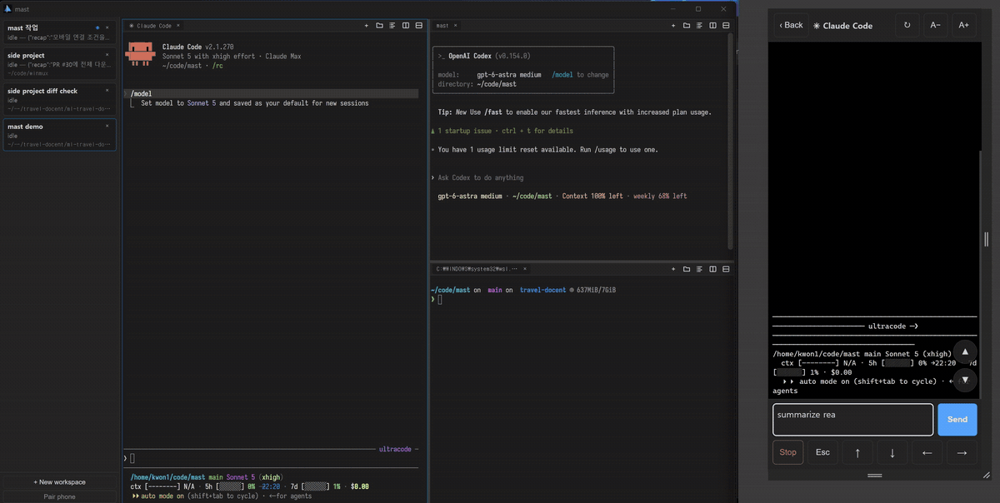

# mast

[](https://github.com/sjkwon-1023/mast/actions/workflows/ci.yml)
[](LICENSE)

**A lightweight terminal multiplexer for Windows + WSL2, made for running several coding agents
side by side.** Split panes and tabs, see at a glance which agent is waiting for you, and answer
it from your desk or your phone. A native Apple Silicon build is available too.



## Why mast

- **Light on your machine.** The app process itself stays around 15 MB. Workspaces you are not
  looking at do not keep a screen alive — only their shells keep running — so a long list of
  workspaces costs almost nothing until you open one. The window is drawn by WebView2, which
  Windows lists as separate `msedgewebview2` processes.
- **Know who needs you.** Claude Code, Codex and Antigravity CLI report whether they are running,
  waiting for your input or done. Each workspace card shows the most urgent tab with the agent's
  last message, and Windows notifies you when one starts waiting.
- **Answer from your phone.** Pair a phone on your home network by QR code, then read output and
  type into any tab — an agent or a plain shell.
- **Pick up where you left off.** Close mast and reopen it: workspaces, splits and tabs come back
  in the directories they were in. Press `Up` in a restored tab to get the command that resumes its
  Claude Code, Codex or OpenCode session, or turn on `autoResume` to have agents that were still
  running relaunch by themselves, one tab at a time.
- **Agents can work together.** Inside a mast terminal, `mast ls` lists the tabs in the workspace
  and `mast send` types into another one, so one agent can hand work to another.
- **One executable.** No installer, no setup wizard. `Ctrl+Shift+R` reloads the window without
  stopping your shells or agents.

## Install on Windows

**You need** Windows 11 (x64 or ARM64) with WebView2, which Windows 11 includes, and WSL2 with a
Linux distribution such as Ubuntu. If WSL is not ready, mast walks you through installing it; the
built-in browser tab works without WSL.

1. **Set up WSL2** if you have not: run `wsl --install` in an administrator PowerShell, restart
   Windows, then open Ubuntu once and create your Linux user.
   ([Microsoft's guide](https://learn.microsoft.com/en-us/windows/wsl/install))
2. **Install your agents inside WSL** (optional — mast is a fine plain terminal too): Claude Code,
   Codex, Antigravity CLI or OpenCode. For full agent status, also run
   `sudo apt install python3 jq coreutils`.
3. **Install mast.** In PowerShell:

   ```powershell
   irm https://raw.githubusercontent.com/sjkwon-1023/mast/main/scripts/win/install.ps1 | iex
   ```

   This puts `mast.exe` in `%LOCALAPPDATA%\Programs\mast`. Run it once and mast appears in the
   Start menu.

The executable is not code-signed. Installing with the line above avoids the SmartScreen warning.
If you download the exe from the [latest release](https://github.com/sjkwon-1023/mast/releases/latest)
in a browser instead, SmartScreen warns once: choose **More info** → **Run anyway**. With Smart
App Control turned on, Windows blocks the unsigned exe either way.

### Updating

In any mast terminal, run:

```sh
mast update
```

Then quit mast completely and open it again. The sidebar shows your version, and mast tells you
when a newer release is out; it never installs anything on its own.

## Install on macOS (Apple Silicon)

```sh
curl -fsSL https://raw.githubusercontent.com/sjkwon-1023/mast/main/scripts/macos/install.sh | bash
```

This installs mast into `/Applications`. Later, `mast update` in a mast terminal does the same;
quit and reopen mast to use the new version. The app is not signed or notarized: install it with
the line above, because a zip downloaded in a browser is blocked by Gatekeeper. See the
[macOS guide](docs/MACOS.md) for details and limits.

## First steps

- On first launch mast opens your default WSL distribution and wires up the agents it finds. If
  something could not be set up, `~/.mast/setup.log` says what and how to fix it.
- **Codex** asks you once to trust mast's hooks (the **Hooks need review** prompt). Accept it to
  get Codex status; until you do, Codex asks again at every launch.
- Split a pane with `Ctrl+Shift+D` or `Alt+Shift+D`, open a tab with `Ctrl+Shift+T`, and start a
  new workspace with `Ctrl+Shift+N`. A new pane or tab opens in the directory you were in.
- When an agent asks for something, its tab and workspace card turn to **needs input**. Click the
  card to jump there.

[How the agent integration works, and setting it up by hand](scripts/wsl/claude-hook-example.md).

## Features

- **Panes, tabs and workspaces** — split either way and drag to resize; every pane has its own
  tabs, and background tabs keep running.
- **Agent status and notifications** — running / needs input / done per tab, the agent's last
  message on the workspace card, and a Windows notification when a tab starts waiting.
  Antigravity CLI reports running and done only.
- **Viewers** — a folder browser, text and Markdown viewers for your WSL files, and a read-only
  **Changes** view of your Git working tree and staged changes (needs Git in WSL).
- **Phone remote (opt-in)** — *Pair phone* shows a QR code. **Secure Remote** needs no setup and
  encrypts the connection; **Local HTTP** is a plain-HTTP mode you turn on in settings. Both work
  only on your own network — mast has no cloud relay, so mobile data or another Wi-Fi reaches your
  PC only through a VPN or tunnel you set up yourself.
  [Details](docs/SETTINGS.md#remote-local-http).
- **Built-in browser tab** — open it with the `◎` button; agents can inspect and click it with
  `mast browser`. [Browser guide](docs/BROWSER.md).
- **Resume and auto-resume** — see *Pick up where you left off* above. `autoResume` runs only
  agents that were still open when mast quit, never one you exited yourself.

## Settings

Change settings from a mast terminal:

```sh
mast config                             # show every setting
mast config set fontSize 15
mast config set autoResume true         # relaunch agents that were running at quit
mast config set remote                  # turn on Local HTTP phone access (port 7331)
mast config reset fontSize
```

Settings live in `%AppData%\app.mast.desktop\settings.json` and take effect after you **quit mast
completely and open it again** (`Ctrl+Shift+R` is not enough). Quitting ends running terminal
processes, so finish your work first. [All settings](docs/SETTINGS.md).

## Keyboard shortcuts

App shortcuts use `Ctrl+Shift` or `Alt+Shift`; every other key goes to the terminal.

| Key | Action |
|---|---|
| `Ctrl+1` … `Ctrl+9` / `Alt+1` … `Alt+9` | Switch workspace by sidebar position |
| `Ctrl+Shift+[` / `]` or `Alt+Shift+[` / `]` | Previous / next workspace |
| `Alt+Shift+↑ ↓ ← →` | Move to the neighboring pane |
| `Ctrl+Tab` / `Ctrl+Shift+Tab` | Next / previous tab in the pane |
| `Ctrl+Shift+T` / `Alt+Shift+T` | New terminal tab |
| `Ctrl+Shift+B` / `Alt+Shift+B` | New folder browser tab |
| `Ctrl+Shift+W` / `Alt+Shift+W` | Close the tab |
| `Ctrl+Shift+D` | Split the pane top/bottom |
| `Alt+Shift+D` | Split along the pane's longer side |
| `Ctrl+Shift+N` / `Alt+Shift+N` | New workspace |
| `Ctrl+Shift+Q` / `Alt+Shift+Q` | Close the workspace |
| `Ctrl+Shift+R` | Reload the window |
| `Ctrl+V` / `Ctrl+Shift+V` / `Shift+Insert` | Paste |
| `Ctrl+C` / `Ctrl+Shift+C` | Copy the selection (with nothing selected, `Ctrl+C` interrupts as usual) |

Drag workspace cards to reorder them. Hold `Alt` for about a second to see the Alt shortcuts on
the buttons. The full list is in [`apps/mast/src/shared/keys.ts`](apps/mast/src/shared/keys.ts).

## Troubleshooting

**A new tab stays empty, or running sessions stop responding.** This is usually WSL running out of
memory rather than mast. WSL2 gets half of your RAM by default; a big build can exhaust it. Raising
its swap in `%UserProfile%\.wslconfig` usually fixes it:

```ini
[wsl2]
swap=8GB
autoMemoryReclaim=gradual
```

Run `wsl --shutdown` to apply it — this ends every WSL session, so do it between tasks. A tab whose
shell never started offers **Retry**.

**Claude Code asks "trust this folder" at every launch.** This happens when it starts in your home
directory (`~`); the answer is kept for project folders. Start agents from a project folder.

## Status

One maintainer, used daily on an x64 Windows 11 desktop. ARM64 is built and checked on every
release but has not run on real hardware yet. Contributor notes live in [`CLAUDE.md`](CLAUDE.md)
and [`docs/WINDOWS-BUILD.md`](docs/WINDOWS-BUILD.md).

## License

MIT — see [LICENSE](LICENSE).
